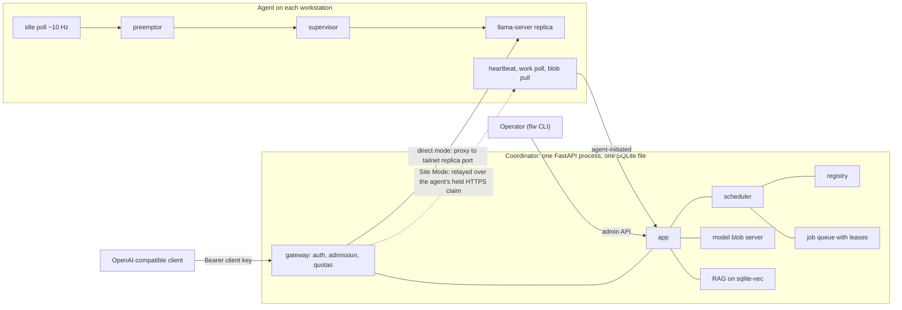

# Fallow

[](https://github.com/Unluckyathecking/fallow/actions/workflows/ci.yml)
[](LICENSE)

Fallow turns the idle workstations on a LAN or tailnet into a governed pool for LLM
inference and batch jobs. A single coordinator owns identity, policy, scheduling and
audit, and exposes an OpenAI-compatible API. An agent on each machine runs complete
quantised models under llama.cpp while nobody is using the machine, and suspends them
within a poll interval of the user touching the keyboard or mouse. The goal is useful
private compute from hardware an organisation already owns, without the people at
those desks ever noticing.

Fallow is pre-alpha. It is built for development, research and supervised pilots on
test machines, has not had a security audit, and is out of scope for high-risk uses
such as grading, admissions or monitoring people ([responsible-use
scope](docs/ai-act-scoping.md)).

## How it works



The **coordinator** is one async FastAPI process over one SQLite database
(`python -m fallow_coordinator serve`, default `127.0.0.1:8330`). It contains:

- a registry of enrollment tokens, agents, client API keys and per-key quotas;
- a durable job queue that splits batch jobs into content-addressed work units and
  hands them out under leases;
- a scheduler with three selectable policies (`capability`, `roundrobin`, `churn_v2`)
  and opt-in speculative backup dispatch for the last units of a job;
- an OpenAI-compatible gateway for `/v1/chat/completions` and `/v1/embeddings`, with
  key auth, model allowlists, requests-per-minute and per-day quotas, a bounded
  admission queue, session affinity and a JSONL request log;
- a range-capable server for model blobs; and
- RAG collections on sqlite-vec, queried at `/v1/rag/collections/{name}/query`.

The **agent** holds no policy. It polls the OS idle API at about 10 Hz, reports
heartbeats and events, pulls and verifies the models it is assigned, and supervises
local `llama-server` replicas, one complete model per machine. Interactive requests
are routed to whichever replica is free, so throughput grows with the number of idle
machines while single-request latency stays that of one machine. Batch work is
pull-based: idle agents long-poll for a leased unit, run it and upload the result,
and the coordinator requeues any lease that expires.

There are two agent implementations speaking the same wire contract. The Python
`fallow_agent` is the reference. The Go agent in [`go-agent/`](go-agent/) (binary
`agentctl`) is the agent for Windows Site Mode desks, and a parity suite runs the
same scenarios against both.

[docs/architecture.md](docs/architecture.md) covers the request flows, module graph,
protocol versioning and trust model in detail.

## Design decisions

Each decision has an ADR in [`docs/adr/`](docs/adr/README.md). The ones that shape
the system:

**Replication, not sharding** ([ADR 000](docs/adr/000-architecture-baseline.md)).
Splitting one model across desktops would make every request depend on several
machines that can each be reclaimed at any moment. A full quantised replica per
machine means losing a machine loses capacity, not requests.

**Preemption is a synchronous thread, not a coroutine** ([ADR
002](docs/adr/002-preemption.md)). The idle poll and the yield decision run on a
dedicated OS thread, and suspending the replica processes is the first side effect
when input resumes, before logging or telling the coordinator. Nothing in the async
stack can delay a yield. The engineering target is p99 under 300 ms from input to
suspended.

**All policy lives in the coordinator.** Agents decide nothing about placement or
access, and they open every control-plane connection themselves: registration,
heartbeats, the work long-poll and blob pulls. A compromised agent can lie about its
own results but cannot reach other agents or act as anyone else.

**Content-addressed, idempotent work units** ([ADR 005](docs/adr/005-queue-store.md)).
A unit's ID is a hash of its job, index and input, and completion is an `INSERT OR
IGNORE`. Duplicate, late and backup completions are harmless by construction, which
is what makes lease expiry and speculative backups ([ADR
056](docs/adr/056-speculative-backup-dispatch.md)) safe.

**Bearer tokens hashed at rest** ([ADR 006](docs/adr/006-registry-auth.md)).
Enrollment tokens, device tokens and client keys are random, shown once, stored only
as SHA-256 digests and compared in constant time. Device tokens and unused enrollment
tokens can be revoked ([ADR 104](docs/adr/104-identity-revocation.md)).

**One wire contract, enforced in CI** ([ADR 036](docs/adr/036-go-schema-codegen.md)).
Pydantic models in `fallow-protocol` generate the committed JSON Schemas, which in
turn generate the Go types. CI fails if either drifts. Module boundaries are also
machine-checked: `lint-imports` forbids the coordinator and agent from importing each
other and keeps the protocol package free of server dependencies.

**Never expose `llama-server`.** It has no authentication, so the agent refuses a
`0.0.0.0` bind. Replicas bind to the tailnet address in direct mode and to loopback
in Site Mode.

## Measured results

The only measurements committed so far come from a two-machine engineering spike
(one Apple Silicon Mac, one Windows PC with an NVIDIA GPU), recorded with raw JSON in
[`experiments/spikes/RESULTS.md`](experiments/spikes/RESULTS.md):

| Metric | Mac | Windows |
| --- | --- | --- |
| Input to suspended, p99, all CPUs saturated (target < 300 ms) | 103.1 ms | 116.3 ms |
| Suspend syscall alone, p99 | 2.44 ms | 0.16 ms |
| CUDA suspend/resume cycles with corrupted output | n/a | 0 of 500 |

The yield time is dominated by the 100 ms poll interval, not the suspend itself. In a
live two-machine run on the same hardware, a real user returning caused a 1.268 ms
yield, warm time to first token through the gateway was 222 ms, and hard-killing one
agent mid-service produced no failed client requests. This is evidence from two
machines, not a fleet study. The planned scheduling experiment
([protocol](docs/experiment.md)) has not been run, and its result files are
placeholders.

## Quickstart

You need Python 3.12 or 3.13, [uv](https://docs.astral.sh/uv/) and Git. This brings
up a coordinator on localhost and exercises the operator CLI and gateway without a
GPU or model.

```bash
git clone https://github.com/Unluckyathecking/fallow.git
cd fallow
uv sync --frozen
```

Create `coordinator.toml`:

```toml
db_path = ".fallow-run/coordinator.db"
blob_dir = ".fallow-run/blobs"
unit_input_dir = ".fallow-run/units"
result_dir = ".fallow-run/results"
events_jsonl_path = ".fallow-run/events.jsonl"
gateway_log_path = ".fallow-run/gateway.jsonl"
admin_key = "replace-with-a-random-admin-key"
```

Start it, then use `flw` from a second terminal:

```bash
uv run python -m fallow_coordinator serve --config coordinator.toml
```

```bash
export FLW_COORDINATOR_URL="http://127.0.0.1:8330"
export FLW_ADMIN_KEY="replace-with-a-random-admin-key"

uv run flw status
uv run flw enroll new-token                  # one-time token for a new agent
uv run flw models register --file "$PWD/model.gguf" \
  --model-id example-model --family example --quant Q4_K_M
uv run flw keys new demo --allow example-model   # prints api_key: once
```

`flw models register` hashes the file and records its path on the coordinator host,
so use any GGUF you have. With no agent enrolled, a chat request is authenticated,
waits in the admission queue for up to 10 seconds, then is shed:

```bash
export CLIENT_KEY="paste-the-api-key-here"
curl -sS http://127.0.0.1:8330/v1/chat/completions \
  -H "Authorization: Bearer $CLIENT_KEY" -H "Content-Type: application/json" \
  -d '{"model":"example-model","messages":[{"role":"user","content":"hi"}]}'
# {"error":{"message":"no replica available for model 'example-model'","type":"no_replica_available"}}
```

To serve a real response, follow [docs/quickstart.md](docs/quickstart.md). It adds an
agent with a `llama-server` binary, enrolls it with the token, assigns the model with
`flw assign`, and sends the same request once the agent is idle.

## Deployment modes

| Mode | Agents | Network and trust | Guide |
| --- | --- | --- | --- |
| Direct (tailnet) | Python or Go agent on macOS (Apple Silicon) or Windows x64 | Every machine on one Tailscale tailnet. The coordinator proxies inference to each agent's replica port on its tailnet address. Fallow adds no transport security of its own here. | [Quickstart](docs/quickstart.md), [deploy/README.md](deploy/README.md) |
| LAN Site Mode | Go agent on Windows 10/11 x64 | No tailnet and no internet needed at the desks. The coordinator is the only LAN listener, over HTTPS. Agents enrol from a per-device join file and connect out only, pinned to the coordinator's key. Replicas stay on loopback and inference is relayed back over the agent's connection. | [Operator runbook](docs/lan-site/operator-runbook.md), [design](docs/lan-site/README.md) |

Site Mode is opt-in and leaves direct deployments unchanged. Agents on macOS and
Windows must run in the logged-in user's session so they can see input, which is why
the installers use a launchd agent and an at-logon Scheduled Task rather than system
services. The coordinator runs on macOS or Linux, and `deploy/coordinator/install.sh`
installs it as a systemd service. Linux agents are only for headless benchmark hosts.

[`deploy/`](deploy/README.md) holds the per-OS installers, one-shot bootstrap
scripts, pinned llama.cpp fetch scripts, an offline install bundle built from
`uv.lock`, and the Site Mode desk bundle. Model weights and llama.cpp are not
shipped; the coordinator can register a local GGUF or fetch one with `flw models
pull`.

## Repository layout

| Path | Contents |
| --- | --- |
| `packages/fallow-protocol` | Pydantic wire types, interface ABCs and schema export |
| `packages/fallow-coordinator` | Registry, queue, scheduler, gateway, model serving, RAG, Site Mode relay |
| `packages/fallow-agent` | Reference agent: idle detection, preemption, supervisor, model cache, workers |
| `packages/fallow-cli` | `flw`, the operator CLI for the admin API |
| `packages/fallow-bench` | Workload driver, churn injector, experiment runner and analysis |
| `packages/fallow-modelmesh` | Chunked, Merkle-verified, signed model manifests and peer fetch (opt-in) |
| `go-agent/` | Go agent (`agentctl`) with types generated from the schemas |
| `schemas/` | Committed JSON Schemas and shared conformance fixtures |
| `deploy/` | Installers, bootstrap scripts, offline and Site Mode bundles |
| `tests/` | Cross-package integration, Site Mode and install acceptance suites |
| `experiments/` | Hardware spikes and research harnesses |
| `docs/` | Architecture, ADRs, runbooks, experiment protocol |

## Testing

```bash
uv sync --frozen --dev
uv run pytest
```

Unit tests need no GPU, model or network. The Site Mode acceptance tests build
`agentctl` from source, so `uv run pytest` also needs a Go toolchain on `PATH`. CI
runs the full quality gate below, the test suite on Ubuntu, macOS and Windows with
Python 3.12 and 3.13, and builds both install bundles:

```bash
uv run ruff check .
uv run ruff format --check .
uv run mypy
uv run lint-imports
uv run python -m fallow_protocol.export_schemas schemas/ && git diff --exit-code -- schemas/
uv build --all-packages
```

For the Go agent:

```bash
python3 schemas/generate_go.py --check
(cd go-agent && go test ./...)
```

Separate workflows run the Python and Go agents through the same parity scenarios and
exercise the macOS and Windows installers on hosted runners. A hosted runner proves
install and removal, not behaviour on a real desk.

## Status and roadmap

The packages are at 0.3.0, and `main` carries unreleased work beyond the `v0.3.0` tag,
including Site Mode, revocation and fleet-wide model placement; see the
[changelog](CHANGELOG.md). Known gaps, as the docs record them:

- The scheduling study comparing `churn_v2` with round robin has not been run.
- Direct mode relies on the tailnet for transport security.
- There is no independent security review, and the release bundles are not
  code-signed.
- Client API keys have no CLI revocation, and the coordinator is a single writer
  with a manual warm-standby promote rather than high availability.
- Results returned by an agent are not verified against ground truth.

Direction beyond that is in [ROADMAP.md](ROADMAP.md).

## Contributing and security

Read [CONTRIBUTING.md](CONTRIBUTING.md) before opening a pull request. Report
vulnerabilities privately as described in [SECURITY.md](SECURITY.md), not in public
issues.

## Licence

Fallow is licensed under the [GNU Affero General Public License v3.0 or
later](LICENSE). Contributions are accepted under the same licence.
